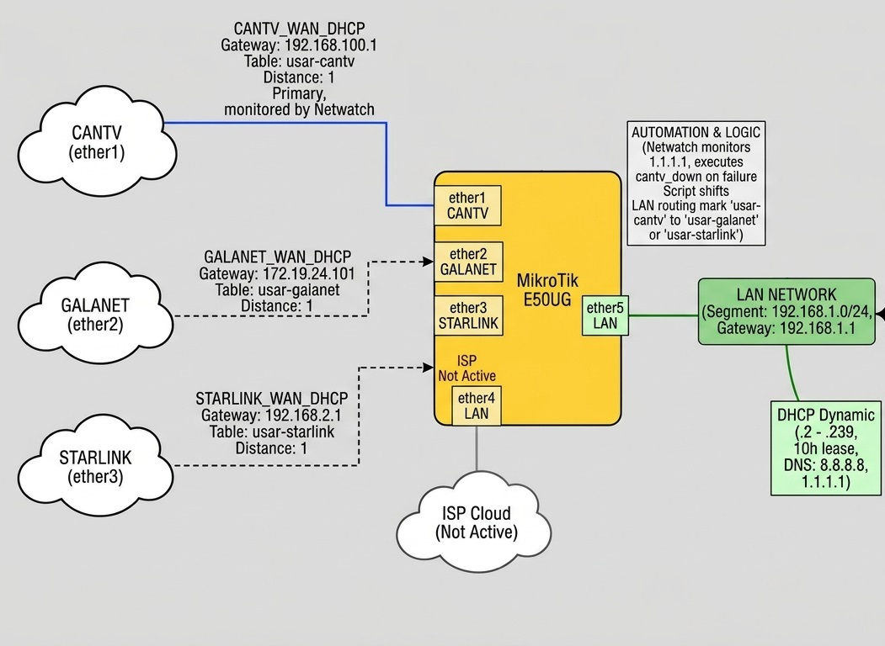

# Documentación de Configuración MikroTik (Failover Multi-WAN)

Configuración de enrutamiento y respaldo automático implementada en un router **MikroTik E50UG** (RouterOS 7.21.4), gestiona múltiples ISP (CANTV, GALANET y STARLINK) con un esquema de alta disponibilidad (HA).




---

## Paso 1. Interfaces de Red (Puertos físicos):

El equipo mapea sus puertos físicos a nombres lógicos identificables para las distintas proveedoras y la red local:
* **`CANTV`** (ether1): Enlace WAN principal.
* **`GALANET`** (ether2): Enlace WAN de respaldo secundario.
* **`STARLINK`** (ether3): Enlace WAN de respaldo terciario / satelital.
* **`ISP`** (ether4): Interfaz de respaldo adicional (actualmente inactiva / *not active*).
* **`LAN`** (ether5): Interfaz de red local (Switch/Bridge local).

Renombrar interfaces fisicas:

Informacion del comando:

## Comando para Renombrar Interfaces en RouterOS (CLI)

```mikrotik
/interface ethernet set [ find default-name=<nombre_interfaz> ] name=<nuevo_nombre>
```

## Desglose del Comando de Interfaz Ethernet

1. `/interface ethernet` $\rightarrow$ Entra al menú de interfaces Ethernet.
2. `find default-name=ether1` $\rightarrow$ Busca la interfaz cuyo nombre por defecto es `ether1`.
3. `set` $\rightarrow$ Modifica los parámetros de la interfaz encontrada.
4. `name=CANTV` $\rightarrow$ Le asigna el nuevo nombre `CANTV`.


```text
/interface ethernet set [ find default-name=ether1 ] name=CANTV
/interface ethernet set [ find default-name=ether2 ] name=GALANET
/interface ethernet set [ find default-name=ether3 ] name=STARLINK
/interface ethernet set [ find default-name=ether4 ] name=ISP
/interface ethernet set [ find default-name=ether5 ] name=LAN
```
---

## Paso 2. Red Local (LAN) y Servidor DHCP
Se configura el direccionamiento interno para la red de la oficina/hogar:
* **Segmento de red (LAN)**: `192.168.1.0/24`.
* **Gateway LAN**: `192.168.1.1`.
* **Pool DHCP**: `192.168.1.2 - 192.168.1.239` (Servidor DHCP `dhcp_lan` concesión de *10 horas*).
* **DNS Asignados por DHCP**: `8.8.8.8` y `1.1.1.1`.
* **Asignaciones Estáticas (Leases)**: Reservas de IP  (servidores, cajas registradoras, impresoras, DVRs, puntos de acceso Deco y equipos de personal clave) en el rango `192.168.1.40` a `192.168.1.247`.

```text
/ip pool add name=dhcp_pool_lan ranges=192.168.1.2-192.168.1.239
/ip dhcp-server add address-pool=dhcp_pool_lan interface=LAN lease-time=10h name=dhcp_lan
/ip address add address=192.168.1.1/24 comment=LAN interface=LAN network=192.168.1.0
/ip dhcp-server network add address=192.168.1.0/24 dns-server=8.8.8.8,1.1.1.1 gateway=192.168.1.1
```
---

## Paso 3: Configuración de Clientes DHCP (WAN)

Configura las interfaces WAN para recibir su configuracion DHCP (CANTV tiene **add-default-route=no** para gestionarlo mediante una tabla fib personalizadas)

```text
/ip dhcp-client add add-default-route=no comment=CANTV_WAN_DHCP interface=CANTV use-peer-dns=no
/ip dhcp-client add comment=GALANET_WAN_DHCP interface=GALANET
/ip dhcp-client add comment=STARLINK_WAN_DHCP interface=STARLINK
/ip dhcp-client add comment=ISP_WAN_DHCP interface=ISP disabled=yes
```
---

## 3. Tablas de Enrutamiento (Routing Tables):

Para permitir que el tráfico salga por rutas específicas según el proveedor, se definieron tres (3) **tablas de enrutamiento basadas en políticas (FIB)**:

1. **`usar-cantv`**: Tabla de enrutamiento (fib) dedicada al tráfico que sale por CANTV.
2. **`usar-galanet`**: Tabla de enrutamiento (fib) dedicada al tráfico que sale por GALANET.
3. **`usar-starlink`**: Tabla de enrutamiento (fib) dedicada al tráfico que sale por STARLINK.

```text
/routing table add fib name=usar-cantv
/routing table add fib name=usar-galanet
/routing table add disabled=no fib name=usar-starlink
```

/ip route add disabled=no distance=1 dst-address=0.0.0.0/0 gateway=192.168.100.1 routing-table=usar-cantv scope=30 target-scope=10
/ip route add disabled=no distance=1 dst-address=0.0.0.0/0 gateway=172.19.24.101 routing-table=usar-galanet scope=30 target-scope=10
/ip route add disabled=no distance=1 dst-address=0.0.0.0/0 gateway=192.168.2.1 routing-table=usar-starlink scope=30 target-scope=10
/ip route add disabled=yes dst-address=1.1.1.1 gateway=192.168.100.1 routing-table=usar-cantv


---

## 4. Enrutamiento y Puertas de Enlace (Gateways):

Las rutas estáticas por defecto (`0.0.0.0/0`) para cada proveedor están asociadas a sus respectivas tablas y saltos (gateways):
* **CANTV**: Gateway a ISP `192.168.100.1` asociado a la tabla `usar-cantv`.
* **GALANET**: Gateway a ISP `172.19.24.101` asociado a la tabla `usar-galanet`.
* **STARLINK**: Gateway a ISP`192.168.2.1` asociado a la tabla `usar-starlink`.
* **Monitoreo de red**: Existe una ruta estática hacia `1.1.1.1` apuntando a `192.168.100.1` bajo la tabla **`usar-cantv`** (actualmente deshabilitada `disabled=yes).

---

## 5. Firewall: Mangle y NAT

* **Mangle (Marcado de Rutas)**:
  * Posee una regla principal en la cadena `prerouting` que captura todo el tráfico proveniente de la red local (`192.168.1.0/24`) dirigido hacia internet (`dst-address=!192.168.1.0/24`) y le asigna la marca de enrutamiento **`usar-cantv`**. Esto define que CANTV sea la vía predeterminada de salida.


```text
/ip firewall mangle add action=mark-routing chain=prerouting comment="Ruta por defecto hacia CANTV" dst-address=!192.168.1.0/24 new-routing-mark=usar-cantv passthrough=no src-address=192.168.1.0/24
```

 

* **NAT (Masquerade)**:

* Contiene reglas de enmascaramiento independientes para traducir las IPs privadas de la LAN hacia las tres interfaces WAN (`CANTV`, `GALANET`, y `STARLINK`), garantizando que cualquier interfaz activa pueda enrutar el tráfico si se le asigna la marca correcta.

 ```text
/ip firewall nat add action=masquerade chain=srcnat comment="NAT CANTV" out-interface=CANTV
/ip firewall nat add action=masquerade chain=srcnat comment="NAT GALANET" out-interface=GALANET
/ip firewall nat add action=masquerade chain=srcnat comment="NAT STARLINK" out-interface=STARLINK
```

---

## 6. Automatización y Monitoreo (Netwatch y Scripts)

* **Herramienta Netwatch**:
  * Monitorea de forma continua al host `1.1.1.1` cada `10s` (con 3 paquetes de sondeo y timeout de 3s).
  * Al haber pérdida de paquetes, ejecuta automáticamente la acción de caída llamando a `/system script run cantv_down`.


 ```text
/tool netwatch add comment="Monitoreo Enlace CANTV" down-script="/system script run cantv_down" host=1.1.1.1 interval=10s packet-count=3 timeout=3s type=simple up-script="/system script run cantv_up"
 ```
* **Script `cantv_down`**:
  * Un script programado en el sistema que evalúa mediante una petición HTTP (`/tool fetch`) a Cloudflare (`speed.cloudflare.com`) utilizando la tabla `usar-cantv` si el enlace principal responde[cite: 2].
  * Si el enlace falla (`on-error`), comprueba si la interfaz `GALANET` está activa (`running`). De estarlo, reescribe dinámicamente la regla de Mangle para desviar el tráfico hacia **Galanet** (`usar-galanet`)[cite: 2].
  * Si Galanet tampoco está disponible, conmuta por seguridad hacia **Starlink** (`usar-starlink`).
    

 ```text
/system script add dont-require-permissions=yes name=cantv_down owner=admin2 policy=ftp,reboot,read,write,policy,test,password,sniff,sensitive,romon source=":local mangleId [/ip firewall mangle find comment=\"Ruta por defecto hacia CANTV\"];\
    \n:local galanetUp [/interface get [find name=\"GALANET\"] running];\
    \n:local testResult 0;\
    \n\
    \n:do {\
    \n    /tool fetch mode=https url=\"https://speed.cloudflare.com/__down\?bytes=5000000\" output=none routing-table=usar-cantv;\
    \n    :set testResult 1;\
    \n} on-error={\
    \n    :set testResult 0;\
    \n}\
    \n\
    \n:if (\$mangleId != \"\") do={\
    \n    :if (\$testResult = 0) do={\
    \n        :if (\$galanetUp = true) do={\
    \n            /ip firewall mangle set \$mangleId new-routing-mark=usar-galanet;\
    \n            :log warning \"ALERTA: CANTV degradado o caido. Redirigiendo trafico a Galanet.\";\
    \n        } else={\
    \n            /ip firewall mangle set \$mangleId new-routing-mark=usar-starlink;\
    \n            :log error \"CRITICO: CANTV y Galanet no disponibles. Conmutando a Starlink.\";\
    \n        }\
    \n    } else={\
    \n        :log info \"VERIFICACION: El rendimiento de CANTV se mantiene estable sobre el umbral.\";\
    \n    }\
    \n}"
 ```

---

## 7. Ajustes de Sistema
* **Zona Horaria**: Configurada en `America/Caracas`.

 ```text
/system clock set time-zone-name=America/Caracas
 ```
  
* **RoMon**: Habilitado (`enabled=yes`) para la gestión administrativa interna entre equipos MikroTik de la red.

 ```text
/tool romon set enabled=yes
 ```
